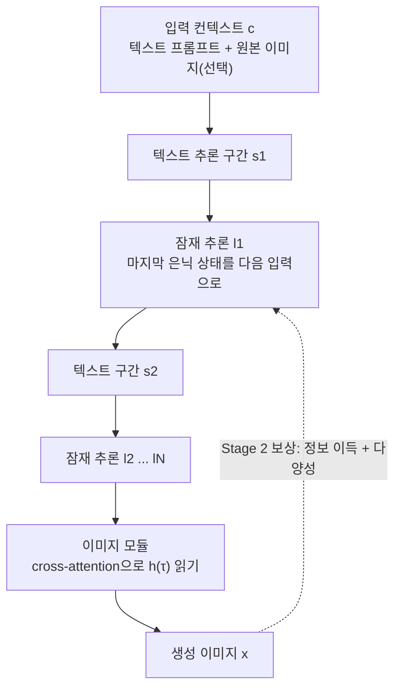

> **논문 원제**: *Latent Reasoning in Continuous Space for Unified Multimodal Models*  
> **학회**: **NeurIPS 2026**  
> **저자**: Byungwoo Jeon, Yoonwoo Jeong, Hyunseok Lee, Minsu Cho, Jinwoo Shin (KAIST AI)  
> **원문 링크**: [arXiv:2610.42149](https://arxiv.org/abs/2610.42149) / [PDF](https://arxiv.org/pdf/2610.42149) / [Hugging Face](https://huggingface.co/papers/2610.42149) / [프로젝트 페이지](https://rootyjeon.github.io/larc-umm/)

---

## 1. 인트로: "생각할 시간"을 줘도 그림은 그대로였다

지난 몇 년간 LLM 연구에서 가장 강력했던 레시피 중 하나는 **test-time scaling**입니다. 답을 내기 전에 Chain-of-Thought로 더 오래 "생각"하게 하면, 즉 추론 시점에 계산을 더 쓰면 성능이 꾸준히 오른다는 것이죠.

그렇다면 텍스트 이해와 이미지 생성을 하나의 모델로 처리하는 **통합 멀티모달 모델(Unified Multimodal Model, UMM)**도 그림을 그리기 전에 더 많이 생각하면 더 좋은 그림을 그릴까요? 직관적으로는 그래야 할 것 같지만, 이 논문은 정반대의 관찰에서 출발합니다.

> 기존 UMM은 추론 예산을 늘려도 LLM 벤치마크에서 보던 매끄러운 성능 향상이 나타나지 않는다. (논문 Introduction, Figure 1)

KAIST·POSTECH·RLWRLD 연구진이 NeurIPS 2026에 발표한 **LARC(Latent Reasoning in Continuous space)**는 이 실패의 원인을 "생각하는 언어"에서 찾고, 해법으로 *연속 공간에서 생각하기*를 제안합니다.

---

## 2. 기존 방식의 한계: 생각과 그림이 서로 다른 언어를 쓴다

Uni-CoT 같은 기존 추론 강화형 UMM은 먼저 텍스트로 추론 과정을 적은 다음, 그 텍스트를 조건으로 이미지를 생성합니다. 논문은 여기서 근본적인 **모달리티 불일치(modality mismatch)**를 지적합니다.

- **추론**은 끊어진 단어 토큰, 즉 *이산(discrete)* 공간에서 일어나고
- **이미지 생성**은 *연속(continuous)* 잠재 공간에서 일어난다.

논문에 따르면 이산적인 추론 체인은 이미지 합성에 필요한 촘촘하고 공간적으로 정렬된(spatially-grounded) 정보를 담기 어렵습니다. 그래서 추론이 결국 "프롬프트를 조금 다듬는" 수준으로 전락하고, 기존 방법은 딱 그 좁은 영역에서만 이득을 본다는 것이죠.

흥미로운 근거가 Ablation(Table 6)에 있습니다. 같은 베이스 모델에서 **토큰 수준 추론**을 붙이면 시각적 추론 벤치마크 MIRA 점수가 오히려 **7.5 → 7.1로 떨어집니다.** 반면 잠재 추론으로 바꾸면 9.7까지 오릅니다. "단어로 생각하는 것" 자체가 시각 과제에서는 손해가 될 수 있다는 신호입니다.

---

## 3. 핵심 아이디어: LARC — 연속 공간에서 생각하기

한 문장으로 요약하면, **추론을 이미지가 만들어지는 공간과 같은 연속 공간으로 옮기자**는 것입니다. LLM에서 단어 없이 은닉 상태로 추론하는 Coconut을 멀티모달 생성으로 확장했습니다.

### 3.1 텍스트와 잠재 추론을 번갈아 (Interleaved Latent Reasoning)

모델이 특수 토큰 `<latent>`를 내보내면 "잠재 모드"로 바뀝니다. 이때는 단어를 디코딩하지 않고, 마지막 트랜스포머 레이어의 은닉 상태 $h_t$를 **그대로 다음 위치의 입력 임베딩**으로 넣습니다.

$$
E_{t+1} = \begin{cases} [E_t;\, h_t] & \text{잠재 모드} \\ [E_t;\, e(x_{t+1})] & \text{언어 모드} \end{cases}
$$

그 결과 추론 궤적은 $\tau = (s_1, l_1, s_2, l_2, \dots, s_N, l_N)$처럼 텍스트 구간 $s_n$과 잠재 구간 $l_n$이 번갈아 나타나고, 마지막에 이미지 모듈이 cross-attention으로 전체 은닉 상태 궤적 $h(\tau)$를 읽어 이미지를 만듭니다.

왜 굳이 텍스트를 섞을까요? 순수 Coconut 방식의 잠재 추론은 **결정론적(deterministic)**이라 강화학습에 필요한 다양한 rollout을 만들 수 없습니다. 텍스트 구간은 확률적으로 샘플링되므로 탐색 다양성을 공급하고, 잠재 구간은 이미지 생성에 필요한 연속 표현을 담당하는 분업 구조입니다.

### 3.2 Stage 1 — 커리큘럼 SFT

처음부터 모든 잠재 단계를 켜면 학습이 불안정하기 때문에, 단계적으로 "말로 하던 생각"을 "벡터로 하는 생각"으로 바꿉니다.

1. FLUX-Reason, WEAVE, ScaleEdit에서 뽑은 **100만 개의 interleaved CoT 샘플**에서 추론 단계 경계마다 `<latent>`를 삽입
2. Phase 0: 잠재 단계 없이 텍스트 추론만 학습
3. Phase k: 앞의 k개 잠재 단계만 활성화 → 마지막 phase에서 전부 활성화 (phase가 바뀔 때마다 학습률 감소)

손실은 텍스트 구간의 next-token prediction과 목표 이미지의 flow-matching 손실의 합입니다. 잠재 단계에는 **정답 라벨이 없고**, gradient가 흘러가며 유용한 표현을 스스로 학습합니다.

### 3.3 Stage 2 — 정보 이득 보상으로 스스로 진화하는 RL

이미지 생성에는 "정답 추론 과정"이 존재하지 않습니다. 그래서 LARC는 외부 평가자 없이 **모델 자신의 지식**으로 보상을 만듭니다. Stage 1 모델을 고정한 참조 모델 $\pi_{ref}$에 대해, 추론 궤적이 목표 이미지의 가능도를 얼마나 끌어올리는지를 측정합니다.

$$
r_{IG}(\tau; x, c) = \log p_{\pi_{ref}}(x \mid c, h(\tau)) - \log p_{\pi_{ref}}(x \mid c)
$$

이 보상의 기댓값은 조건부 상호정보량 $I_{\pi_{ref}}(x; h(\tau) \mid c) \ge 0$이 됩니다. 이미지 모듈에서 로그 가능도를 직접 구할 수 없으므로, **같은 노이즈를 공유한 두 flow-matching 손실의 차이**로 근사합니다.

여기에 모든 잠재 단계가 똑같은 벡터로 붕괴(collapse)하는 것을 막는 다양성 보상 $r_{div}$(잠재 단계 간 $1-\cos$ 평균)을 더해 $R = r_{IG} + \lambda_{div} \cdot r_{div}$를 GRPO로 최적화합니다. RL 단계에서는 이해(understanding) 전문가만 업데이트하고, 생성 전문가는 보상 계산에 재사용합니다. 학습에는 A100 8장으로 Stage 1에 약 300 GPU시간, Stage 2에 96 GPU시간이 들었습니다(Appendix A).

---

## 4. 실험 결과

베이스 모델 BAGEL 위에 LARC를 학습하고, 추론 강화형 UMM인 Uni-CoT와 비교했습니다.

| 벤치마크 (지표) | BAGEL (베이스) | Uni-CoT | **LARC** |
|---|---|---|---|
| GenEval Overall (T2I) | 0.81 | 0.83 | **0.88** |
| DPG-Bench Overall (프롬프트 충실도) | 85.07 | 85.56 | **90.04** |
| OneIG-Bench Overall | 0.764 | 0.790 | **0.866** |
| CompBench LC-T (이미지 편집) | 20.434 | 20.215 | **22.509** |
| MIRA (시각적 추론) | 7.5 | 10.6 | **11.7** |
| MMMU (멀티모달 이해) | 55.3 | 55.5 | **56.2** |

<small>출처: 논문 Table 1~5</small>

- **GenEval**에서 BAGEL 대비 **+7%p**로, 참고용으로 함께 제시된 GPT-4o(0.84)보다도 높은 점수입니다. 가장 크게 오른 세부 항목은 **속성 결합(Attribute Binding)으로 0.63 → 0.78(+15%p)**. "빨간 컵과 파란 책"처럼 여러 속성을 정확히 짝지어야 하는 구성적 과제에서 잠재 추론의 효과가 컸다는 해석입니다.
- **이미지 편집**(CompBench)에서도 PSNR 24.3 → 25.7, LPIPS 0.069 → 0.049로 화질 지표가 함께 개선됐습니다.
- 이미지 생성용으로 추가한 추론이 **이해 능력을 해치지 않고** 오히려 MME·MMB·MMMU까지 소폭 올렸다는 점도 통합 모델로서 중요한 포인트입니다.

### Test-time scaling: 더 생각할수록, 거의 공짜로 좋아진다

논문의 가장 큰 주장은 LARC가 **뚜렷한 test-time scaling을 보인 최초의 추론 강화형 UMM**이라는 것입니다. 잠재 추론 예산을 늘릴수록 이미지 생성·편집·시각적 추론 성능이 단조 증가하고, 같은 계산량의 best-of-N 샘플링보다 일관되게 좋았습니다(Figure 1).

비용 측면의 비교가 특히 인상적입니다(A100 1장, 배치 1, 샘플당 시간).

| 추론량 | BAGEL + Best-of-N | LARC (잠재 단계 L) |
|---|---|---|
| 1 | 46.5초 | 46.8초 |
| 4 | 187.1초 | 47.0초 |
| 10 | 469.0초 | **48.0초** |

<small>출처: 논문 Table 11</small>

Best-of-N은 이미지를 N번 통째로 다시 생성해야 하지만, LARC는 이해 전문가의 forward pass 일부만 늘어나기 때문에 잠재 단계를 10개로 늘려도 L=1 대비 **1.2초**만 추가됩니다.

### Ablation에서 보이는 것들

- **학습 단계**(Table 8): Stage 1만으로도 GenEval 0.81 → 0.83, Stage 2(RL)를 더하면 0.88. MIRA는 9.7 → 11.7. 정답 추론 없이 정보 이득만으로 RL이 의미 있게 작동했습니다.
- **다양성 보상**(Table 12): $\lambda_{div}=0$이면 잠재 단계 간 코사인 유사도가 0.97까지 치솟으며 붕괴하고, MIRA가 11.7 → 9.8로 떨어집니다. $\lambda_{div}=0.1$이 최적이었습니다.
- **텍스트를 섞는 설계**(Table 7): interleaved 방식이 구성적 생성(0.79 → 0.81)과 편집(21.02 → 21.46)에서 앞섰지만, 시각적 추론은 순수 잠재 추론(Naive)이 9.9로 interleaved(9.7)보다 약간 높았습니다. 모든 지표에서 일방적으로 우세한 것은 아닙니다.

---

## 5. 한계와 열린 질문

**논문이 밝힌 한계** (Appendix E)
- 현재는 flow-matching 이미지 헤드를 가진 UMM에서만 검증되었습니다. 이산 토큰으로 이미지를 만드는 UMM으로의 확장은 향후 과제입니다.
- 잠재 추론 궤적만큼 추론 시 계산이 추가됩니다(위 표처럼 작은 편이지만 0은 아닙니다).

**제 생각에 추가로 따져볼 점**
- **베이스 모델이 BAGEL 하나**입니다. 다른 아키텍처에서도 같은 크기의 이득이 나는지는 아직 알 수 없습니다.
- 평가는 주로 **모델 기반 지표**(논문 표현으로 MLLM-as-a-Judge 포함)이며, 본문에서 사람 선호도 평가는 찾을 수 없었습니다. GenEval에서 GPT-4o를 넘었다는 결과도 같은 자동 평가 틀 안에서의 비교로 읽는 것이 안전합니다.
- 정보 이득 보상은 **참조 모델 자신의 가능도**에 기대는 자기 보상입니다. 다양성 보상 없이 바로 붕괴했다는 결과(Table 12)는 이 보상이 지름길을 찾기 쉽다는 신호이기도 해서, 더 긴 RL이나 다른 데이터에서의 안정성이 궁금합니다.
- 벡터로 생각하는 만큼 **추론 과정을 사람이 읽기 어려워집니다.** 텍스트 구간이 일부 남아 있긴 하지만, 왜 그 그림이 나왔는지 설명하기는 토큰 CoT보다 어렵습니다.
- Test-time scaling 곡선은 Figure 1 그래프로만 제시되어, 예산별 정확한 수치는 본문 표로 확인할 수 없었습니다.

---

## 6. 실무자·연구자를 위한 시사점

1. **"추론 공간을 출력 공간에 맞춰라."** 이 논문의 가장 일반적인 교훈입니다. 이미지·오디오·로봇 행동처럼 연속적인 출력을 내는 모델에 텍스트 CoT를 그대로 이식하면 오히려 손해일 수 있습니다(Table 6의 MIRA 7.5 → 7.1).
2. **Best-of-N의 저렴한 대안.** 생성 품질을 올리려고 여러 장을 뽑아 고르는 서비스라면, 같은 품질 향상을 훨씬 적은 시간으로 얻을 가능성이 있습니다(469초 vs 48초).
3. **정답 없는 과제의 RL 보상 설계.** "이 중간 과정이 최종 결과의 가능도를 얼마나 올렸나"라는 정보 이득 보상은 검증기(verifier)가 없는 생성 과제 전반에 응용해 볼 만한 레시피입니다. 단, 붕괴를 막는 정규화는 필수입니다.
4. 한국 연구진(KAIST·POSTECH·RLWRLD)이 멀티모달 추론의 핵심 질문에 정면으로 답한 연구라는 점도 반갑습니다.

---

### 📌 요약 (TL;DR)
- 기존 추론 강화형 UMM이 "생각"을 늘려도 그림이 좋아지지 않은 이유는, 추론(이산 토큰)과 이미지 생성(연속 공간)의 **모달리티 불일치** 때문이다.
- LARC는 은닉 상태를 다음 입력으로 넣는 **연속 공간 잠재 추론**을 커리큘럼 SFT와 **정보 이득 보상 RL**로 학습해, BAGEL 대비 GenEval 0.81 → 0.88 등 전 벤치마크에서 개선했다.
- 잠재 단계를 늘릴수록 성능이 오르는 **test-time scaling**을 보였고, 10단계에 48초로 Best-of-10(469초)보다 훨씬 효율적이다.

---

<small>이 리뷰는 AI(Claude)가 논문 원문을 분석해 초안을 작성하고, 작성자(신동환)가 검토·승인한 뒤 게시되었습니다. 수치와 표현은 반드시 원문으로 확인하세요.</small>
