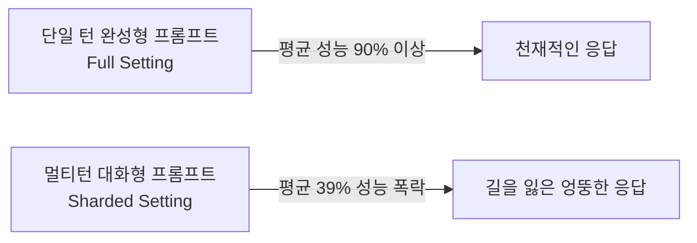

> **논문 원제**: *LLMs Get Lost In Multi-Turn Conversation*  
> **수상**: **ICLR 2026 Outstanding Paper Award (최우수 논문상)**  
> **저자**: Philippe Laban, Hiroaki Hayashi, Yingbo Zhou, Jennifer Neville (Salesforce Research)  
> **원문 링크**: [arXiv:2505.06120](https://arxiv.org/abs/2505.06120) / [공식 프로젝트 페이지](https://lost-in-conversation.github.io/)

---

## 1. 인트로: 모든 AI 유저가 겪었던 '그 답답함'의 실체

AI를 써본 사람이라면 누구나 한 번쯤 겪어본 답답함이 있습니다.
- 첫 질문을 던졌을 땐 천재처럼 완벽한 코드를 짜주던 AI가,
- "아, 여기서 이 조건 추가해 줘", "저 함수는 이렇게 바꿔줘" 하며 **대화가 3~4턴만 넘어가면 갑자기 앞선 말을 잊어버리거나 엉뚱한 헛소리(Hallucination)**를 뱉기 시작합니다.

우리는 흔히 "프롬프트를 내가 잘못 썼나?" 혹은 "컨텍스트 윈도우가 부족한가?"라고 자책하곤 했습니다.
하지만 **2026년 ICLR 최고 논문상(Outstanding Paper)**을 수상한 이 논문은 충격적인 결론을 내립니다:

> **"당신 탓이 아닙니다. 현존하는 모든 최강의 LLM들은 멀티턴 대화로 들어가는 순간 성능이 평균 39% 폭락합니다."**

Salesforce Research 연구진은 GPT-4.1, Claude 3.7 Sonnet, Gemini 2.5 Pro, Llama-3.1 등 전 세계 15개 최정상급 LLM을 대상으로 **무려 20만 건 이상의 시뮬레이션 대화**를 수행하여 이 현상을 과학적으로 증명해 냈습니다.

---

## 2. 충격적인 실험 결과: 거대 모델도 예외는 없다

연구진은 코딩(Code), 데이터베이스(DB), 액션(Agent), 수학(Math), 요약(Summary) 등 6개 핵심 태스크에서 두 가지 환경을 비교했습니다:
1. **Full (단일 턴)**: 모든 조건과 맥락을 한 번에 완벽하게 제공한 프롬프트.
2. **Sharded (멀티 턴)**: 현실 사용 환경처럼, 유저가 여러 번에 나누어 조건을 점진적으로 수정·추가하는 대화.

### 모델별 성능 하락폭 (단일 턴 vs 멀티 턴)
- **GPT-4.1**: 91.7% ➔ **70.7%** (-21.0%p)
- **Claude 3.7 Sonnet**: 85.4% ➔ **57.2%** (-28.2%p)
- **Gemini 2.5 Pro**: 90.2% ➔ **64.3%** (-25.9%p)
- **Llama 3.1 8B**: 68.2% ➔ **38.1%** (-30.1%p)

놀랍게도 **더 크고 비싼 파라미터의 모델(GPT-4.1, Claude 3.7)이라도 이 붕괴를 전혀 피하지 못했습니다.**
하락폭은 단순 능력(Aptitude)의 저하가 아니라, **신뢰성(Unreliability)이 112% 이상 폭증**하며 발생했습니다. 즉, 같은 질문을 해도 어떤 턴에서는 맞고 어떤 턴에서는 처참하게 틀리는 '불안정성'이 극대화된 것입니다.

---

## 3. LLM은 왜 대화 속에서 길을 잃는가? (4대 근본 원인)

논문은 LLM이 대화에서 길을 잃어버리는(Lost in Conversation) 4가지 치명적인 구조적 결함을 지적합니다:

1. **섣부른 결론 도출 (Premature Solutions)**:
   - 유저가 불완전한 질문을 던지면 "어떤 조건을 원하시나요?"라고 되물어야 하는데, 모델은 멋대로 가정을 세우고 첫 턴부터 완성된 답변을 내놓으려 합니다.
2. **오답에 대한 과도한 집착 (Over-reliance on Prior Errors)**:
   - 이전 턴에서 자신이 내놓은 (틀린) 답변을 버리지 못하고, 그 위에 자꾸 살을 덧붙이다가 코드가 비대해지고 버그가 누적됩니다.
3. **가운데 대화 실종 (Lost-in-the-Middle in Turns)**:
   - LLM의 어텐션 메커니즘 특성상 **'첫 번째 턴(최초 질문)'과 '마지막 턴(직전 메시지)'에만 과도하게 가중치**를 두고, 중간 2~4턴에서 나눈 핵심 피드백을 까먹습니다.
4. **불필요한 과다 답변 (Excessive Verbosity)**:
   - 너무 장황하게 설명하려다 보니 자신이 생성한 토큰들에 스스로 어텐션을 빼앗겨 유저의 핵심 지시사항을 놓칩니다.

---

## 4. 실무자를 위한 대처법: 우리는 어떻게 써야 하는가?

이 연구 결과가 AI 개발자와 유저들에게 주는 실전 가이드는 명확합니다:

1. **"대화로 고쳐나가기"를 멈춰라**:
   - 코드가 틀렸을 때 "거기서 세 번째 줄 고쳐줘"라고 5턴 동안 실랑이하지 마세요. 성능이 39% 떨어진 상태입니다.
   - **새로운 채팅(New Chat)을 열고, 수정된 요구사항을 합쳐서 단일 턴(Full Instruction)으로 다시 던지는 것**이 훨씬 정확합니다.
2. **에이전트 시스템 설계의 교훈**:
   - AI 에이전트 개발 시 대화 히스토리 전체를 무지성으로 Context에 누적하는 방식은 최악입니다.
   - 각 턴의 핵심 상태를 요약한 State JSON만 남기고 이전 대화 찌꺼기를 정리하는 Context Compaction이 필수적입니다.

---

### 📌 요약 (TL;DR)
- ICLR 2026 최고논문상 수상작은 현존 모든 LLM의 멀티턴 성능이 단일턴 대비 평균 39% 폭락함을 20만 번의 실험으로 증명했다.
- 모델이 멍청해지는 게 아니라 '신뢰성(Unreliability)'이 무너지며 오답에 집착하기 때문이다.
- AI로 중요한 작업을 할 때는 긴 대화를 이어가지 말고, 맥락을 모아 **새 대화창에서 단일 턴으로 실행**하라.
