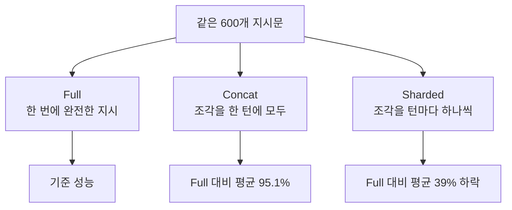

> **논문 원제**: *LLMs Get Lost In Multi-Turn Conversation*  
> **수상**: **ICLR 2026 Outstanding Paper Award** ([ICLR 공식 발표](https://blog.iclr.cc/2026/04/23/announcing-the-iclr-2026-outstanding-papers/))  
> **저자**: Philippe Laban, Hiroaki Hayashi, Yingbo Zhou, Jennifer Neville (Microsoft Research · Salesforce Research)  
> **원문 링크**: [arXiv:2505.06120](https://arxiv.org/abs/2505.06120) / [공식 프로젝트 페이지](https://lost-in-conversation.github.io/)  
> <small>본문 수치는 arXiv v1 기준입니다.</small>

---

## 1. 인트로: 모든 AI 유저가 겪었던 '그 답답함'의 실체

AI를 써본 사람이라면 누구나 한 번쯤 겪어본 답답함이 있습니다.
- 첫 질문엔 완벽한 코드를 짜주던 AI가,
- "아, 여기서 이 조건 추가해 줘", "저 함수는 이렇게 바꿔줘" 하며 **대화를 이어갈수록 앞선 조건을 놓치거나 엉뚱한 답**을 내놓기 시작합니다.

우리는 흔히 "프롬프트를 내가 잘못 썼나?"라고 자책하곤 했습니다.
하지만 **ICLR 2026 최우수 논문상(Outstanding Paper)**을 받은 이 논문은 이렇게 정리합니다:

> 실험한 모든 최상위 오픈·클로즈드 LLM이, 조건이 여러 턴에 나뉘어 주어지는 **멀티턴 대화에서 단일턴보다 성능이 크게 떨어졌고**, 6개 생성 태스크 평균 **39% 하락**했다. (Abstract)

Microsoft Research와 Salesforce Research 연구진은 GPT-4.1, Gemini 2.5 Pro, Claude 3.7 Sonnet, o3, DeepSeek-R1, Llama 3.1-8B 등 **8개 모델 계열의 15개 LLM**(8B 소형부터 300B+ 대형까지)을 대상으로 **20만 건 이상의 시뮬레이션 대화**를 돌려 이 현상을 정량적으로 보여줬습니다.

---

## 2. 실험 설계: 같은 문제를 '한 번에' vs '나눠서'

연구진은 **코드, 데이터베이스(Text-to-SQL), 액션(API 호출), Data-to-text, 수학, 요약** 6개 태스크의 600개 지시문을 세 가지 방식으로 대화시켰습니다.

1. **Full (단일 턴)**: 모든 조건을 한 번에 담은 완전한 지시.
2. **Concat (단일 턴, 조각 나열)**: 지시를 잘게 쪼갠 조각(shard)들을 **한 턴에 모두** 나열.
3. **Sharded (멀티 턴)**: 같은 조각들을 실제 대화처럼 **한 턴에 하나씩** 공개.

핵심은 **Concat이 거의 떨어지지 않는다**는 점입니다(평균 95.1%). 정보를 쪼갰다고 정보가 사라진 게 아니라, **여러 턴에 걸쳐 나눠 주는 것 자체**가 문제라는 뜻입니다.

### 모델별: 멀티턴(Sharded)에서 단일턴(Full) 대비 몇 %를 유지했나

| 모델 | Concat / Full | **Sharded / Full** |
|---|---|---|
| Claude 3.7 Sonnet | 100.4% | **65.9%** |
| Gemini 2.5 Pro | 100.1% | **64.5%** |
| o3 | 98.1% | **64.1%** |
| Llama 3.1-8B | 91.6% | **62.5%** |
| GPT-4.1 | 97.9% | **61.8%** |
| DeepSeek-R1 | 103.6% | **60.8%** |
| GPT-4o | 94.5% | **57.9%** |

<small>출처: 논문 Table 1 마지막 두 열 (6개 태스크 평균). 15개 모델 전체 범위는 50.5% ~ 66.1%.</small>

**더 크고 비싼 모델도, 추론(reasoning) 모델도 예외가 아니었습니다.** 15개 모델 모두 Sharded에서 단일턴 성능의 50~66% 수준에 머물렀습니다.

### 진짜 원인: 능력이 아니라 '불안정성'

논문은 성능 하락을 **능력(Aptitude)**과 **불안정성(Unreliability)**으로 나눠 분석합니다.

- 능력(잘 됐을 때의 성능)은 멀티턴에서 **평균 16% 하락**에 그쳤지만,
- 불안정성(같은 지시를 여러 번 돌렸을 때 결과의 편차)은 **평균 112% 증가**, 즉 2배 이상으로 치솟았습니다.
- 같은 지시에 대해 가장 잘된 실행과 가장 못된 실행의 차이가 **평균 50%p**에 달했습니다.

즉, 멀티턴에서 모델이 갑자기 멍청해진다기보다 **어떤 때는 맞고 어떤 때는 크게 틀리는 '들쭉날쭉함'**이 폭증하는 것이 핵심입니다. 단일턴에선 똑똑한 모델일수록 안정적이었지만, 멀티턴에선 모든 모델의 불안정성이 비슷하게 높았습니다.

---

## 3. LLM은 왜 대화 속에서 길을 잃는가? (논문이 짚은 4가지 원인)

논문(Appendix F)은 대화 기록 분석으로 네 가지 원인을 제시합니다.

1. **섣부른 답안 제시 (Premature answer attempts)**:
   - 조건이 덜 주어졌는데도 모델이 스스로 가정을 세우고 이른 턴부터 완성된 답을 내놓으려 합니다. 이 가정이 이후 혼란의 씨앗이 됩니다.
2. **이전(틀린) 답에 대한 과도한 의존 (Answer bloat)**:
   - 앞서 내놓은 답을 버리지 못하고 그 위에 덧붙이다 보니, 답이 점점 길고 비대해집니다.
3. **가운데 턴 소실 (Loss-of-middle-turns)**:
   - 모델이 **첫 턴과 마지막 턴**의 내용에 치우쳐 답을 고치고, 중간 턴에서 받은 정보는 덜 반영하는 경향이 관찰됐습니다.
4. **과도하게 장황한 답변 (Overly verbose responses)**:
   - 답이 길어질수록 가정이 더 많이 끼어들고, 논문은 이것이 사용자 발화에 대한 주의를 흐리는 것으로 추정합니다.

---

## 4. 그럼 어떻게 써야 할까?

### 사용자를 위한 논문의 권고 (Section 7.4)

1. **시간이 허락하면, 다시 시작하라 (Try again)**:
   - 대화가 원하는 방향으로 가지 않으면, 같은 대화에서 계속 고치기보다 **새 대화에서 다시 묻는 편이 훨씬 나을 수 있습니다.**
2. **다시 묻기 전에 합쳐라 (Consolidate before retrying)**:
   - 흩어진 조건을 **하나의 지시로 합쳐** 새 대화에 넣으세요(Concat 실험이 근거). 논문은 모델에게 *"Please consolidate everything I've told you so far"*라고 요청해 요약을 받은 뒤, 그것을 새 대화에 붙여 넣는 방법도 제안합니다.

### 에이전트·시스템 개발자를 위한 시사점

- 논문은 이전 사용자 발화를 반복해 주는 두 전략(RECAP, SNOWBALL)을 실험했습니다(GPT-4o, GPT-4o-mini). 개선은 있었지만 Full/Concat 수준에는 못 미쳤고, 현실적인 SNOWBALL은 Full→Sharded 하락을 **15~20% 정도만** 줄였습니다(Section 7.1).
- **온도(temperature)를 0으로 낮춰도 해결되지 않았습니다.** 단일턴에선 불안정성이 크게 줄었지만, 멀티턴에선 사용자·모델 온도를 모두 0으로 해도 약 30%의 불안정성이 남았습니다(Section 7.2).
- 제 생각에는, 대화 기록을 그대로 쌓기보다 **지금까지 확정된 요구사항을 하나의 지시로 정리해 매 턴 다시 주는 방식**(논문의 Consolidate 전략을 시스템으로 옮긴 것)이 실무에서 가장 쉬운 완화책입니다. 다만 논문 결과대로 이것도 '근본 해결'은 아니며, 저자들은 LLM 자체가 멀티턴을 제대로 지원해야 한다고 주장합니다.

---

## 5. 한계

- 영어 지시문, 분석형(비창작) 태스크에 한정됩니다.
- 멀티턴 대화의 사용자 역할은 LLM 기반 시뮬레이터가 맡았습니다.
- 문서 번역처럼 턴마다 독립적으로 처리할 수 있는 태스크에서는 성능 하락이 나타나지 않았습니다(Section 7.3). 즉 이 현상은 **조건이 누적되며 전체 답을 바꿔야 하는 생성 태스크**에서 두드러집니다.

---

### 📌 요약 (TL;DR)
- ICLR 2026 최우수 논문상 수상작. 15개 LLM, 20만 건 이상의 시뮬레이션에서 **멀티턴 + 불완전한 지시** 상황의 성능이 단일턴 대비 평균 39% 떨어졌다.
- 원인은 능력 저하(평균 -16%)보다 **불안정성 급증(평균 +112%)**: 같은 질문에도 결과가 크게 들쭉날쭉해진다.
- 중요한 작업은 대화를 길게 끌지 말고, **조건을 하나로 모아 새 대화에서 한 번에** 물어보라.
